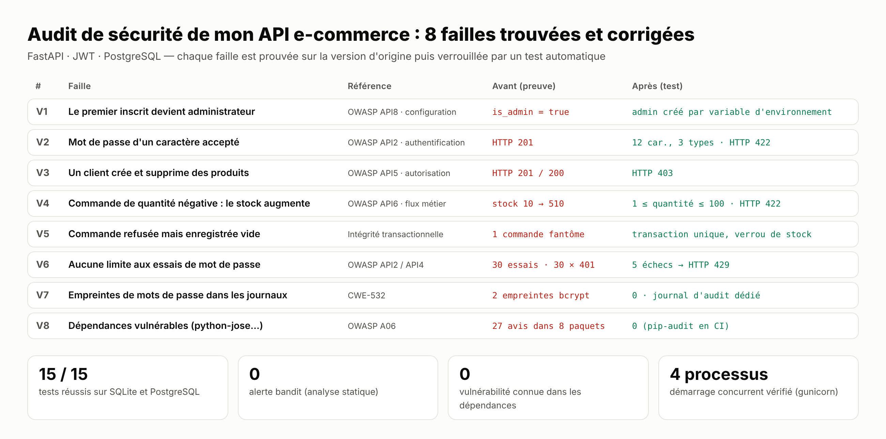

# 🛒 API e-commerce sécurisée (FastAPI) : audit et correction de ma propre API



[](https://github.com/madjiguenedotesene/api-ecommerce-securisee/actions/workflows/ci.yml)


API REST d'une boutique en ligne (dropshipping) : catalogue de produits et de variantes, commandes avec gestion du stock, comptes clients et administrateur.

J'ai écrit la **première version** en 2025. Pour ce dépôt, je l'ai **auditée comme le ferait un attaquant** : 8 failles trouvées, chacune **prouvée** sur la version d'origine (`scripts/poc_version_origine.py`), **corrigée**, puis **verrouillée par un test automatique**. Rapport complet : [docs/audit.md](docs/audit.md).

## 🔍 Les failles les plus parlantes

- **Prise de contrôle à l'installation** : le premier compte inscrit devenait administrateur. Sur un serveur fraîchement déployé, n'importe quel visiteur rapide prenait la main.
- **Contrôle d'accès cassé** (OWASP API5) : tout client connecté pouvait créer, modifier ou supprimer des produits.
- **Manipulation du stock** : une commande de quantité −500 faisait passer le stock de 10 à 510. L'API répondait « erreur 500 »… après avoir écrit en base.
- **Secrets dans les journaux** : le mode de débogage SQL écrivait les empreintes de mots de passe dans les logs.
- **27 vulnérabilités connues** dans les dépendances, dont une bibliothèque JWT sans correctif disponible (python-jose, remplacée par PyJWT).

## 🏗️ Fonctionnalités

| Point d'accès | Public | Client | Administrateur |
|---|---|---|---|
| `GET /products/`, `GET /products/{id}` | ✅ (sans fournisseur ni stock) | ✅ | ✅ |
| `POST /users/` (inscription), `POST /token` (connexion) | ✅ | | |
| `POST /orders/`, `GET /orders/me` | | ✅ | ✅ |
| `POST/PATCH/DELETE /products/`, `POST /variants/` | | ❌ 403 | ✅ |
| `GET /orders/` (toutes, avec fournisseur), `PATCH /orders/{id}` | | ❌ 403 | ✅ |

Commandes **transactionnelles** (tout ou rien, verrou sur le stock), statuts de commande fermés, prix figé dans chaque ligne de commande, journal d'audit des actions d'administration.

## 🚀 Lancer

```bash
git clone https://github.com/madjiguenedotesene/api-ecommerce-securisee.git
cd api-ecommerce-securisee
cp .env.example .env          # renseigner SECRET_KEY, POSTGRES_PASSWORD, ADMIN_PASSWORD
docker compose up -d --build  # API sur http://127.0.0.1:8000/docs
```

Sans Docker :
```bash
pip install -r requirements-dev.txt
pytest -q                     # 15 tests (SQLite) ; DATABASE_URL=postgresql://… pour PostgreSQL
bandit -q -r app && pip-audit -r requirements.txt
```

## ✅ Vérifications

| Contrôle | Résultat |
|---|---|
| Tests automatiques (sécurité + parcours métier) | **15 / 15** sur SQLite **et** PostgreSQL 16 |
| Analyse statique `bandit` | 0 alerte |
| `pip-audit` sur les dépendances | 0 vulnérabilité connue |
| Démarrage avec 4 processus gunicorn | sans erreur (voir le bug corrigé dans l'audit) |

La CI GitHub Actions rejoue tout à chaque commit, avec un vrai PostgreSQL. L'image Docker n'a pas été construite dans mon environnement de travail ; la CI s'en charge.

## 📁 Structure

```
├── app/
│   ├── main.py            # application, initialisation, en-têtes de sécurité
│   ├── config.py          # configuration obligatoire par variables d'environnement
│   ├── securite.py        # bcrypt, JWT, rôles, limiteur de tentatives
│   ├── models.py          # modèles et validation stricte des entrées
│   └── routers/           # auth, users, products, variants, orders
├── tests/                 # tests de sécurité (V1 à V7) et fonctionnels
├── scripts/poc_version_origine.py   # preuves de concept contre la v1
├── docs/audit.md          # rapport d'audit
├── Dockerfile · docker-compose.yml · .env.example
```

## 🧠 Compétences démontrées

Sécurité applicative (OWASP API Top 10) · revue de code et preuves de concept · authentification JWT et contrôle d'accès par rôle · tests de non-régression de sécurité · transactions et concurrence (PostgreSQL) · analyse statique et audit de dépendances en CI · FastAPI, SQLModel, Docker

## 👤 Auteure

**Madjiguene SENE** · [LinkedIn](https://www.linkedin.com/in/madjiguene-dote-sene/) · [GitHub](https://github.com/madjiguenedotesene)
